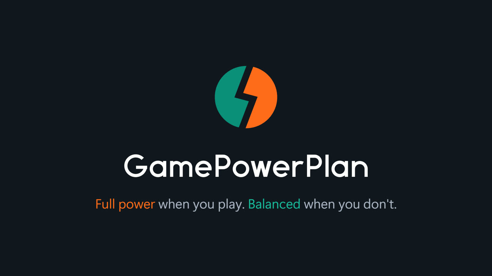
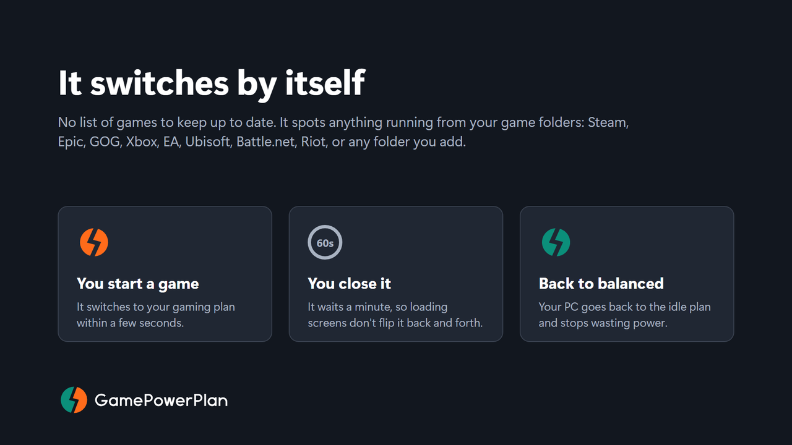
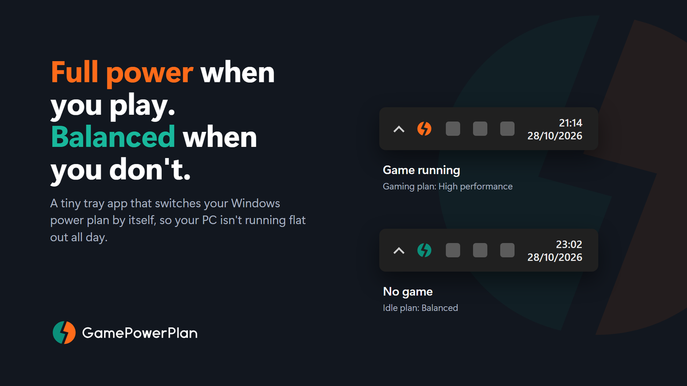
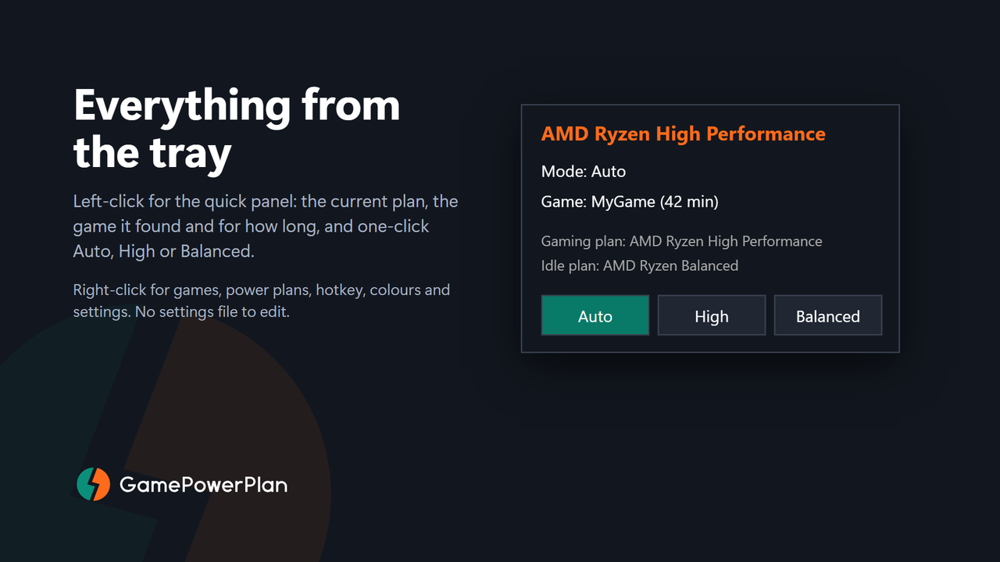

<h1 align="center">
  <picture>
    <source media="(prefers-color-scheme: dark)" srcset="docs/logo-dark.svg">
    
  </picture>
</h1>

<p align="center">A tiny Windows tray app that puts your PC on High performance while you're gaming, and back to Balanced when you're not.</p>

<p align="center">
  <a href="https://apps.microsoft.com/detail/9PF9KW933WVG"><b>Get it on the Microsoft Store</b></a> ·
  <a href="https://nimbonk.fyi/assets/gamepowerplan.mp4">Watch the video</a> ·
  <a href="https://nimbonk.fyi/privacy/">Privacy</a>
</p>

[](https://nimbonk.fyi/assets/gamepowerplan.mp4)

▶ [Watch the 21-second video](https://nimbonk.fyi/assets/gamepowerplan.mp4) (it has sound)

## Why I made it

Electric isn't cheap, and my PC was sitting on full performance all day while I did nothing heavier than reading email. I wanted it to switch up when I start a game and back down when I'm done, without me having to think about it. That's all this does.

I use it on my own Ryzen PC, on Windows 10 and 11. The whole app is one C# file, so have a read if you're curious.

## Get it

The easiest way is the [Microsoft Store](https://apps.microsoft.com/detail/9PF9KW933WVG). Microsoft signs the Store version, so you won't get SmartScreen or antivirus warnings. If you'd rather build it yourself, that's further down.

## How it works



Every 5 seconds it looks at what's running. It doesn't keep a list of game names. It checks where each program lives on disk, and if it's inside a game folder (Steam, Epic, GOG, Riot, Xbox, Ubisoft, EA, or one you've added), it counts as a game. The launchers' own background programs (Epic's and Riot's) are ignored, so having a launcher open doesn't count.

Got games installed somewhere else? When you first start it, it offers to **Scan for games**, and you can run that again from the Games menu any time. It checks the game lists Epic, GOG and Ubisoft keep, looks through your drives for files that only games come with (like Unity and Unreal engine files), then shows you a list to tick. It only adds what you tick, and it only runs when you ask.

- Start a game and it switches to your gaming plan.
- Close it and it waits 60 seconds before going back to your idle plan, so loading screens and launcher restarts don't make it flip back and forth.
- While you're playing it only checks that the one game is still running, so it costs next to nothing.

It only touches the power plan when something actually changes.

## Which plans it picks

It looks at what's on your PC:

- Gaming: AMD Ryzen High Performance if you've got it, otherwise Windows' own High performance.
- Idle: AMD Ryzen Balanced if you've got it, otherwise Windows' own Balanced.

It won't pick Ultimate Performance on its own. That plan uses more power and runs hotter without making games any faster. You can still choose it, or any other plan, from the menu.

## The tray icon



Teal means you're on your idle plan, orange means you're on your gaming plan. You can change both colours.



Left-click it for the quick panel: the plan you're on, the mode, which game it found and how long you've been playing, plus Auto, High and Balanced buttons.

Right-click for everything else:

- Auto, Force gaming plan, Force idle plan
- Games: scan for games, add a game by picking its .exe or folder, remove folders, and ignore programs that shouldn't count. If something keeps wrongly kicking it into high performance, "Ignore detected program" sorts it.
- Power plans: pick your gaming and idle plans
- Settings: grace period, check interval, hotkey, icon colours, notifications, start with Windows
- Reload settings, Open settings file, Exit

It's all in the menu, so you never have to edit a file.

## If something else changes your plan

If Windows or another program switches your power plan behind its back, you'll get a notification and it switches it back. You can turn the notifications off, or tell it to leave the plan alone, in Settings. It can tell the plan was changed, but not what changed it.

Force modes hold too. Force a plan and it stays there.

## Hotkey

You can set a global hotkey in Settings (it needs Ctrl or Alt in it). It cycles through Auto, forced gaming and forced idle, and shows a notification so you know which one you're on. There's no hotkey by default, so it won't clash with anything.

## Settings file

Settings live in `GamePowerPlan.cfg` next to the exe, and it's created the first time the app runs. If you edit it by hand, hit Reload settings in the tray menu. If Windows won't let it write next to the exe (in Program Files, say), it uses `%APPDATA%\GamePowerPlan\` instead. The Store version always uses that one.

## Build it yourself

You don't need to install anything, because Windows already comes with a C# compiler. Put `GamePowerPlan.cs`, `GamePowerPlan.manifest`, `GamePowerPlan.ico` and `build.bat` in one folder and run `build.bat`. Or open a terminal there and run this (it's all one line):

```
C:\Windows\Microsoft.NET\Framework64\v4.0.30319\csc.exe /target:winexe /out:GamePowerPlan.exe /win32manifest:GamePowerPlan.manifest /win32icon:GamePowerPlan.ico /r:System.Windows.Forms.dll /r:System.Drawing.dll GamePowerPlan.cs
```

Then run `GamePowerPlan.exe`. If an older copy is already running, exit it from the tray first, because Windows won't let you replace an exe that's running.

## Good to know

- It doesn't touch your games. No injecting, no reading game memory, no overlays, no drivers. It asks Windows where each program lives and changes the power plan, nothing else. I can't promise every anti-cheat will be happy with every background program, though, so use it at your own risk.
- There's no prebuilt exe here. It isn't code signed, so SmartScreen would warn about an unknown publisher, and some antivirus tools get twitchy about anything that looks at running programs and adds a startup entry. Grab the Store version, or build it from the source.
- Games installed outside the usual folders won't be picked up until you add them, with Scan for games or by adding their folder from the Games menu.
- There's no network code, and it collects nothing. Here's the [privacy policy](https://nimbonk.fyi/privacy/).
- The Store version needs "full trust" because sandboxed apps can't read the paths of running programs or change the power plan. It still doesn't read memory or inject anything, and it's all there in `GamePowerPlan.cs`.
- The `msix` folder is the Store packaging.

## Licence

MIT. See the LICENSE file.

---

<p align="center">
  Made by
  <a href="https://nimbonk.fyi">
    <picture>
      <source media="(prefers-color-scheme: dark)" srcset="docs/nimbonk-dark.svg">
      
    </picture>
  </a>
</p>
